# 🏭 Smart PCB Defect Inspection & Robotic Sorting Cell
### *High-Performance Industrial AI Vision, Siemens S7-1200 PLC, Factory I/O 3D Digital Twin & Asynchronous Snap7 Integration*

[](https://support.industry.siemens.com/)
[](https://www.siemens.com/)
[](https://factoryio.com/)
[](https://github.com/ultralytics/ultralytics)
[](https://github.com/gijzelaerr/python-snap7)
[](https://github.com/orkun11261/pcb-copper-trace-inspection)
[](https://opensource.org/licenses/MIT)

---

## 📌 Executive Summary / Proje Özeti

This repository contains the complete industrial automation and edge AI vision architecture for an **Automated Optical Inspection (AOI) & Robotic Sorting Cell**. Engineered for high-speed Surface Mount Technology (SMT) and Printed Circuit Board (PCB) manufacturing lines, the cell inspects bare and populated circuit boards in real time for critical trace failures—principally open circuit discontinuities (`open_circuit`) and shorts.

The cell synchronizes an **asynchronous multi-threaded Python runtime** with a **Siemens SIMATIC S7-1200 PLC (TIA Portal V18)** and a **Factory I/O 3D Digital Twin**. To prevent camera jitter and maintain high-speed line efficiency, defect inference is decoupled into a dedicated background worker, while a dynamic 10-second inspection hold and hardware-level Watchdog timer ensure deterministic, fail-safe operation.

> [!NOTE]
> **Model Training & Dataset Pipeline**:
> The comprehensive dataset annotation, augmentations, loss curves, and training experiments for `pcb_model_V2.pt` are documented in the dedicated repository:
> 🔗 **[orkun11261/pcb-copper-trace-inspection](https://github.com/orkun11261/pcb-copper-trace-inspection)**.

---

## 🏛️ System Architecture & Data Interconnect

The operational pipeline interconnects physical/simulated sensors, Cartesian robotics, communication buffers, and deep learning inference engines:

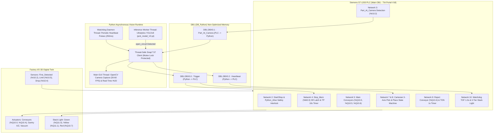

---

## 🗄️ DB1 ("DB_Python") Industrial Memory Mapping

Communication utilizes native Siemens S7 Protocol (ISO-on-TCP RFC1006 via Port 102). In **TIA Portal V18**, DB1 has **Optimized Block Access turned OFF** to enforce standard offset addressing:

| Absolute Address | Variable Name | Data Type | Flow Direction | Functional Description |
| :--- | :--- | :---: | :---: | :--- |
| **`DB1.DBX0.0`** | `Trigger` | `BOOL` | Python &rarr; PLC | **Defect Alarm Signal**. Written to `1` (True) by Python when an `open_circuit` or defect is detected. Overrides the 10-second inspection hold, latches `Stop_Mem (%M2.0)`, and commands the Cartesian robot to initiate rejection. |
| **`DB1.DBX0.1`** | `Part_At_Camera` | `BOOL` | PLC &rarr; Python | **Inspection Trigger**. Set to `1` by PLC when PCB arrives at optical sensor `%I10.2`. Initiates the 10-second inspection countdown in Python. |
| **`DB1.DBX0.2`** | `Heartbeat` | `BOOL` | Python &rarr; PLC | **Safety Keepalive Pulse**. Python cyclically writes a `1` (True) pulse every 250ms to feed the PLC's 1.0s `TOF` (Timer Off-Delay) watchdog timer. The PLC ladder logic captures the pulse, refreshes `%M8.0 Python_Alive`, and immediately resets `DB1.DBX0.2` back to `0` (False) within the cyclic scan. |

> [!IMPORTANT]
> **TIA Portal V18 Configuration**:
> 1. In CPU Properties &rarr; *Protection & Security* &rarr; *Connection Mechanisms*, enable **"Permit access with PUT/GET communication from remote partner"**.
> 2. In DB1 Properties &rarr; *Attributes*, uncheck **"Optimized block access"**.

---

## ⚡ Asynchronous Python Architecture & 10-Second Dynamic Window

In real-world AOI systems, executing high-resolution deep learning inference on the main thread causes UI stutter, dropped camera frames, and unpredictable cycle times. Our architecture implements complete **concurrency separation**:

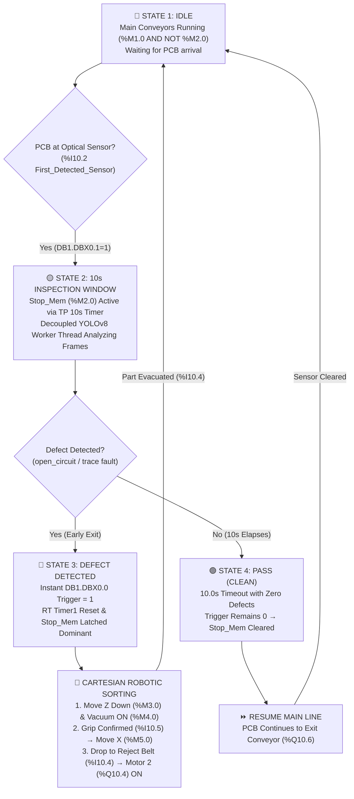

1. **Decoupled OpenCV Capture Loop**: 
   - Runs independently at 30–60 FPS.
   - Overlays real-time status banners, bounding boxes, inspection countdown progress, and S7 connection health.
2. **Worker Thread Double-Buffering**:
   - Frames are fed into a thread-safe `queue.Queue(maxsize=2)`. When the worker is busy, intermediate frames are dropped to guarantee minimal inference latency.
3. **10-Second Dynamic Inspection Window & Early Exit Mechanism**:
   - When the PCB reaches optical sensor `%I10.2`, the PLC halts the main belt via `Timer1` (`TP 10s`) and asserts `DB1.DBX0.1 = 1`.
   - **Early Defect Exit (Bypassing the 10s Window)**: A standard IEC Pulse Timer (`TP`) cannot be cleared merely by de-asserting its input condition. Therefore, if the YOLO model identifies an `open_circuit` defect during the 10-second window, Python **instantly** writes `DB1.DBX0.0 = 1`. In the PLC ladder logic, this `Trigger` bit acts as a direct, overriding `SET` input to the `Stop_Mem (%M2.0)` SR flip-flop and commands a Timer Reset (`RT` instruction on `Timer1`) to abort the remaining pulse time. The inspection window is terminated immediately, an alarm triggers, and the Cartesian gantry engages without waiting for the 10-second timer to expire.
   - **Pass Timeout**: If 10.0 seconds elapse with zero defects detected, the piece is confirmed **"PASS (SAĞLAM)"**. The trigger remains `0`, the pulse timer expires naturally, `Stop_Mem` resets, and the PCB moves smoothly downstream along the main conveyor.

---

## 🧠 Model Training & Performance Benchmarks

The inference engine runs **YOLOv8** (`pcb_model_V2.pt`), fine-tuned to classify bare PCB copper trace defects:

```
Models & Architecture:
├── Base Architecture: Ultralytics YOLOv8s
├── Model Weights: models/pcb_model_V2.pt
├── Primary Target: open_circuit (Kopuk Bakır Hat Hatası)
└── Dedicated Training Repo: https://github.com/orkun11261/pcb-copper-trace-inspection
```

---

## 🛠️ Siemens TIA Portal V18 LADDER Logic (Main OB1)

The complete PLC control logic is structured across 10 modular networks:

### Network 2: Start / Stop Network & Safety Interlock
- **Function**: Establishes system power sealing (`%M1.0 Start_Mem`) via Start PB (`%I10.0`) and Stop PB (`%I10.1`).
- **Fail-Safe Electrical Logic**: Physical `Stop PB` is wired as **Normally Closed (NC)** for fail-safe wire-break detection. Under normal operating conditions, `%I10.1` delivers a constant 24V DC (`1`) to the PLC. Therefore, inside the PLC ladder program, it is examined with a **Normally Open contact** (`--[  ]--`) to monitor electrical continuity. Pressing the button or a broken cable immediately de-energizes `%I10.1` (`0`), breaking the rung.
- **Fail-Safe Interlock**: Interlocked with `%M8.0 Python_Alive`. If Python disconnects or fails, `%M8.0` drops to `0`, breaking the seal and halting the entire station immediately.
- **LADDER Diagram**:

  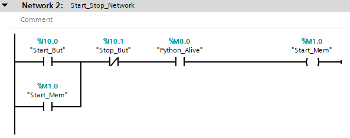

---

### Network 3: Part Detection at Vision Inspection Zone
- **Function**: When the station is active (`%M1.0`), optical sensor `%I10.2` detects a board, and the robot is not descending (`NOT %M3.0`), the PLC writes `1` to `DB1.DBX0.1 Part_At_Camera`, starting Python's inspection window.
- **LADDER Diagram**:

  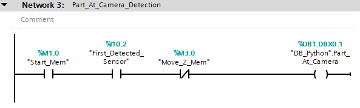

---

### Network 4: Conveyor Stop Memory (SR Latch & TP 10s Timer)
- **Function**: Latches `%M2.0 Stop_Mem` using pulse timer `Timer1` (`TP 10s`) upon PCB arrival.
- **Early Defect Exit Logic**: If Python detects an `open_circuit`, `DB1.DBX0.0 Trigger` activates the `SET` dominant input of the `Stop_Mem` SR latch and executes a timer reset instruction (`RT`) on `Timer1`. This converts the transient 10s pulse into a continuous hold until the Cartesian robot transfers the defective board to conveyor 2 (`%I10.4 Second_Band_First_Sensor`), which resets `Stop_Mem` and restarts the main line.
- **LADDER Diagram**:

  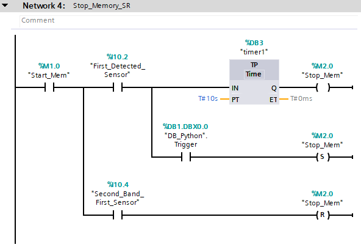

---

### Network 5: Main Conveyor Synchronized Motor Control
- **Function**: Synchronously energizes Entry Conveyor (`%Q10.0`), Curved Conveyor (`%Q10.5`), and Exit Conveyor (`%Q10.6`) when `%M1.0 AND NOT %M2.0`.
- **LADDER Diagram**:

  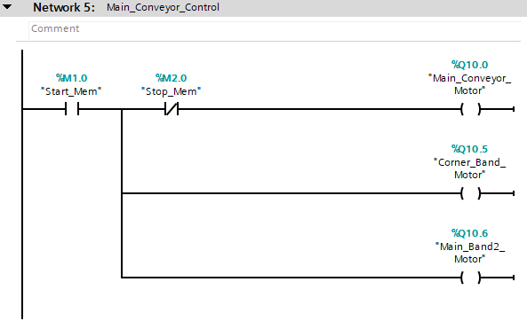

---

### Network 6: Defect Processing Memory (SR Latch)
- **Function**: SET by Python defect trigger (`DB1.DBX0.0`), latching `%M7.0 Defect_Process_Active`. RESET once the robot clears the board to conveyor 2 sensor (`%I10.4`).
- **LADDER Diagram**:

  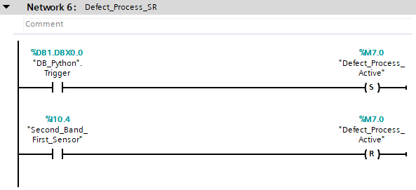

---

### Network 7: Cartesian 3-Axis Pick & Place State Machine
- **State 1 (Descent & Suction)**: When `%M7.0` is active and board is at sensor `%I10.2`, robot moves down (`%M3.0 Move_Z_Mem`) and engages vacuum (`%M4.0 Grab_Mem`).
- **State 2 (Lift & Horizontal Transfer)**: Vertical limit sensor `%I10.5 Machine_Sensor` confirms board acquired &rarr; resets Z-axis and moves gantry along X-axis (`%M5.0 Move_X_Mem`).
- **State 3 (Release & Home Return)**: PCB arrives at secondary conveyor sensor (`%I10.4`) &rarr; releases vacuum (`%M4.0 RESET`), returns X and Z to home position.
- **LADDER Diagram**:

  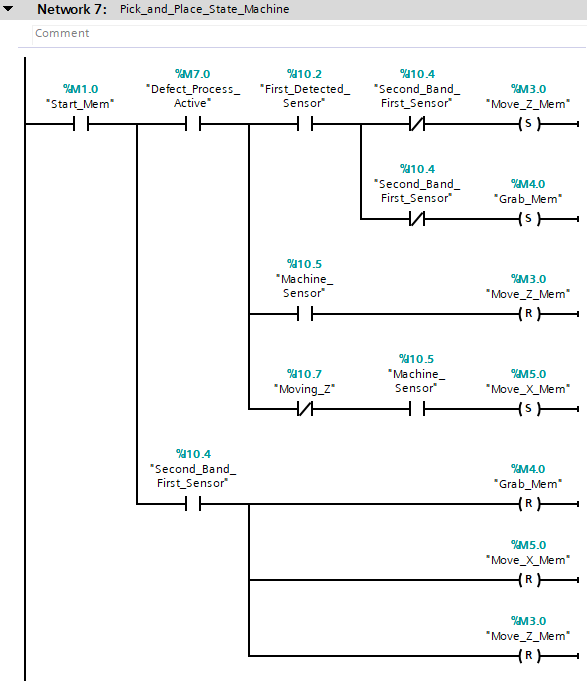

---

### Network 8: Robot Physical Actuator Drivers
- **Function**: Drives physical PLC outputs: Z-Axis (`%Q10.1`), Vacuum Suction Cup (`%Q10.2`), and X-Axis (`%Q10.3`). Includes `Timer2` (`TON 2s`) delay for controlled descent before dropping onto reject belt.
- **LADDER Diagram**:

  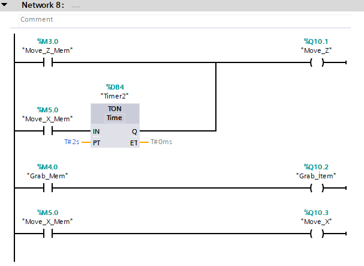

---

### Network 9: Second Conveyor Reject Line Control
- **Function**: Activated when defective item is transferred onto conveyor 2 (`%I10.4`), setting `%M6.0` and driving reject motor `%Q10.4`. `Timer3` (`TON 1s`) delays shutdown after discharge sensor `%I10.3` clears to guarantee full evacuation.
- **LADDER Diagram**:

  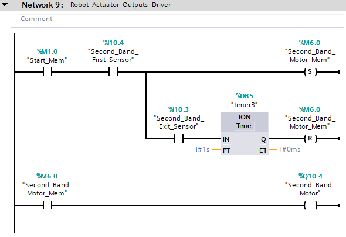

---

### Network 10: Hardware Watchdog & 3-Tier Signal Stack Light
- **Watchdog LADDER**: `Timer5` (`TOF - Timer Off-Delay, 1.0s`) is continually re-triggered by `DB1.DBX0.2 Heartbeat`. Python sends a `1` (True) pulse every 250ms. In every PLC scan where `DB1.DBX0.2` is detected High, `TOF` is refreshed, holding `%M8.0 Python_Alive` at `1`. Immediately downstream of the timer block, the ladder resets `DB1.DBX0.2 := FALSE`. If the communication heartbeat ceases for > 1.0s, `%M8.0` drops to `0`, triggering an emergency line stop.
- **Stack Light Behavior**:
  - **Green Light (`%Q11.0`)**: System Running & Python Online (`%M1.0 AND %M8.0`).
  - **Yellow Light (`%Q11.1`)**: System Paused / Standby & Python Online (`NOT %M1.0 AND %M8.0`).
  - **Red Light (`%Q10.7`)**: Communication Fault / Python Offline (`NOT %M8.0`).
- **LADDER Diagram**:

  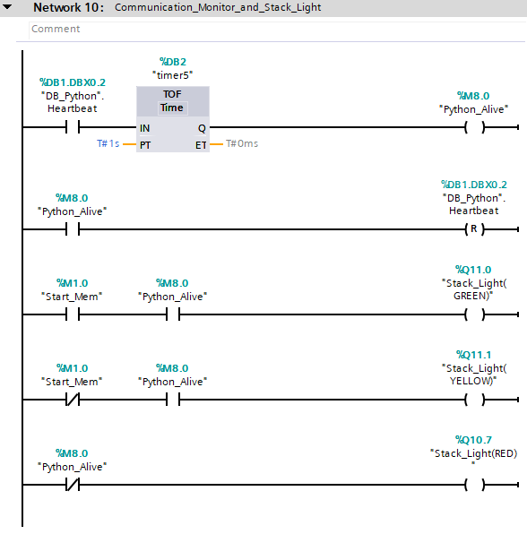

---

## 🎮 Factory I/O 3D Digital Twin Mapping

The 3D virtual cell replicates physical factory dynamics, allowing complete hardware-in-the-loop validation:

| Driver Signal | Tag Name | PLC Address | Type | Physical Component in 3D Scene |
| :--- | :--- | :---: | :---: | :--- |
| **Input** | `Start PB` | `%I10.0` | `BOOL` | Operator console green push button (Normally Open). |
| **Input** | `Stop PB` | `%I10.1` | `BOOL` | Operator console red emergency stop pushbutton. Physically wired Normally Closed (NC); examined in PLC ladder as Normally Open (`--[  ]--`) for fail-safe wire-break monitoring. |
| **Input** | `First_Detected_Sensor` | `%I10.2` | `BOOL` | Retroreflective optical sensor under inspection camera. |
| **Input** | `Reject_Discharge_Sensor` | `%I10.3` | `BOOL` | Optical sensor at discharge ramp of secondary belt. |
| **Input** | `Second_Band_First_Sensor`| `%I10.4` | `BOOL` | Optical sensor at robotic deposit position on reject line. |
| **Input** | `Machine_Sensor` | `%I10.5` | `BOOL` | Cartesian gantry vertical touch/vacuum grip switch. |
| **Output** | `Main Conveyor` | `%Q10.0` | `BOOL` | Primary entry belt conveyor drive motor. |
| **Output** | `Move Z Actuator` | `%Q10.1` | `BOOL` | Pneumatic Z cylinder driving vacuum cup down. |
| **Output** | `Grab Item Actuator` | `%Q10.2` | `BOOL` | Pneumatic vacuum generator / suction valve. |
| **Output** | `Move X Actuator` | `%Q10.3` | `BOOL` | High-speed Cartesian horizontal belt gantry drive. |
| **Output** | `Second Conveyor Motor` | `%Q10.4` | `BOOL` | Secondary defect evacuation belt conveyor motor. |
| **Output** | `Curved Conveyor` | `%Q10.5` | `BOOL` | 90-degree curved transport conveyor. |
| **Output** | `Exit Conveyor` | `%Q10.6` | `BOOL` | Final accepted product output conveyor. |
| **Output** | `Stack Light Red` | `%Q10.7` | `BOOL` | Emergency Stop / Watchdog Timeout indicator. |
| **Output** | `Stack Light Green` | `%Q11.0` | `BOOL` | Active production run indicator. |
| **Output** | `Stack Light Yellow` | `%Q11.1` | `BOOL` | Standby / Paused line indicator. |

---

## 🚀 Quickstart & Commissioning Guide

### 1. Clone & Set Up Python Environment
```bash
git clone https://github.com/orkun11261/pcb-defect-robotic-sorting.git
cd pcb-defect-robotic-sorting

# Create and activate virtual environment
python -m venv .venv
source .venv/bin/activate  # On Windows: .venv\Scripts\activate

# Install dependencies
pip install -r requirements.txt
```

### 2. Configure Siemens S7-1200 / PLCSIM
1. Open **Siemens TIA Portal V18**.
2. Retrieve the project archive `plc/PCB_Sorting_Cell_V18.zap18` via **Project &rarr; Retrieve...** (or reconstruct the ladder networks using the schematics in [plc/README.md](plc/README.md)).
3. Verify PUT/GET permissions are checked and DB1 Optimized Block Access is unchecked.
4. Download to Siemens S7-1200 CPU (or S7-PLCSIM).

### 3. Launch Factory I/O Digital Twin
1. Open `factory_io/PCB_Sorting_Cell.factoryio` in Factory I/O.
2. Select **Siemens S7-1200** driver, configure Host IP (`192.168.0.1`), and connect.

### 4. Run Live Vision Inspection System

> [!WARNING]
> **Virtual PLC Simulation Note (S7-PLCSIM & Snap7 Communication)**:
> Standard Siemens **S7-PLCSIM** (V18) runs in an isolated virtual process and **does NOT** accept external TCP/IP connections on Port 102 from third-party client applications like `python-snap7`.
> If you are testing with a virtual PLC rather than physical hardware, you must use one of the following methods:
> 1. **Siemens S7-PLCSIM Advanced** (V4.0/V5.0/V6.0): Create an instance with its **Virtual Ethernet Adapter** enabled and assigned a dedicated IP address on your local subnet (e.g., `192.168.0.1`).
> 2. **NetToPLCSim**: If using standard S7-PLCSIM, launch the open-source **[NetToPLCSim](https://nettoplcsim.sourceforge.net/)** utility with Administrator privileges to capture and route incoming TCP Port 102 traffic to the internal PLCSIM interface.
> *(When running on a laptop without physical or simulated PLCs, simply run the application with the `--mock` flag).*

```bash
# Live production run (Connects to S7-1200 / S7-PLCSIM Advanced on port 102)
python src/vision_inspection.py --plc-ip 192.168.0.1

# Headless / Laptop simulation mode (No physical PLC, PLCSIM, or camera needed)
python src/vision_inspection.py --mock
```
*Tip: In `--mock` mode, press `s` to simulate a PCB arriving at the optical sensor, and `d` to simulate instantaneous YOLO defect detection.*

---

## 📂 Repository Directory Layout

```
pcb-defect-robotic-sorting/
├── assets/
│   ├── plc_networks/                 # TIA Portal V18 LADDER network screenshots
│   │   ├── network_2_start_stop.png
│   │   ├── network_3_part_detection.png
│   │   ├── network_4_stop_memory_sr.png
│   │   ├── network_5_main_conveyor.png
│   │   ├── network_6_defect_process_sr.png
│   │   ├── network_7_pick_and_place.png
│   │   ├── network_8_robot_actuators.png
│   │   ├── network_9_second_conveyor.png
│   │   └── network_10_watchdog_stacklight.png
├── factory_io/
│   ├── PCB_Sorting_Cell.factoryio.txt# Digital Twin scene documentation
│   └── README.md                     # Scene setup and driver binding guide
├── models/
│   ├── pcb_model_V2.pt.txt           # Model weights pointer & Git LFS notes
│   └── README.md                     # Training repo link & inference benchmarks
├── plc/
│   ├── PCB_Sorting_Cell_V18.zap18    # TIA Portal V18 project archive backup
│   └── README.md                     # Network-by-network engineering breakdown
├── src/
│   ├── __init__.py
│   └── vision_inspection.py          # Asynchronous Snap7, YOLOv8 & OpenCV HUD
├── .gitignore                        # Python, PyTorch, TIA Portal, Factory I/O ignores
├── LICENSE                           # MIT License
├── README.md                         # Main repository documentation
└── requirements.txt                  # Production dependencies
```

---

## 👨‍💻 Author & Engineering Credits

- **Lead Engineer**: [Orkun Kara](https://github.com/orkun11261)
- **Model Training & Research**: [pcb-copper-trace-inspection](https://github.com/orkun11261/pcb-copper-trace-inspection)
- **License**: MIT License - Free for industrial, research, and academic applications.
